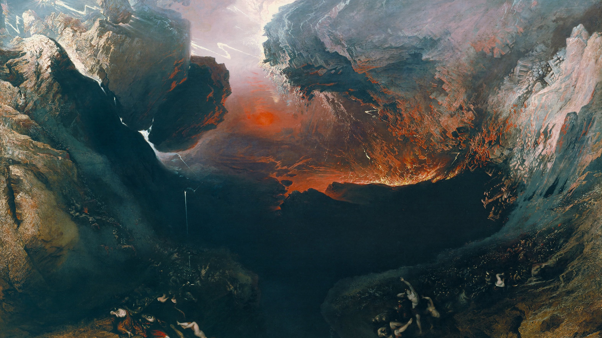
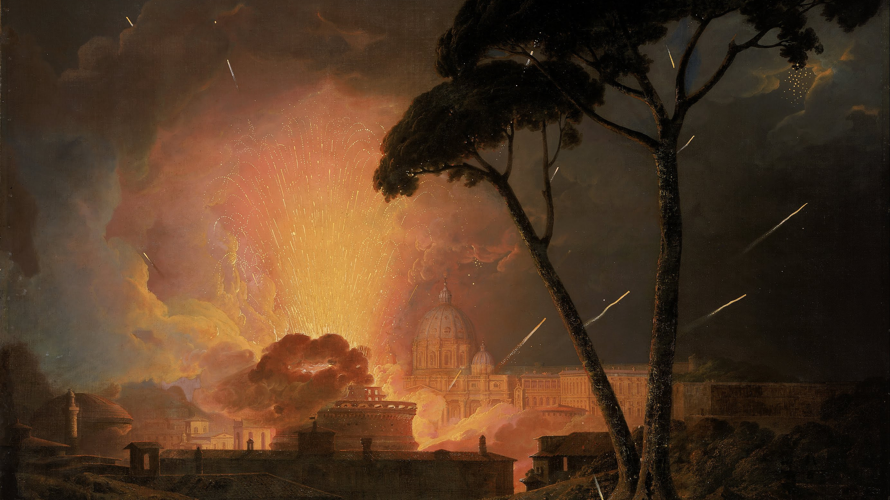
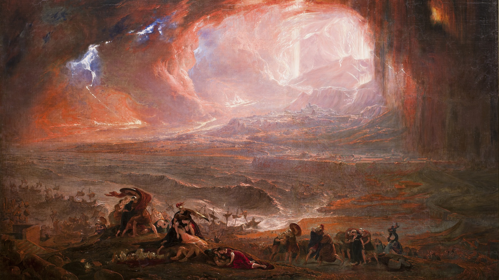

# Fahrenheit for Omarchy

A warm, dark [Omarchy](https://omarchy.org) theme ported from the iTerm2
"Fahrenheit" color scheme: pure black background, cream text, and orange accents.








## Install

```bash
omarchy theme install https://github.com/tracer123/omarchy-fahrenheit-theme.git
```

This clones the theme into `~/.config/omarchy/themes/fahrenheit` and applies
it. Switch back to it later with `omarchy theme set fahrenheit` or the theme
switcher.

**Heads up:** installing replaces any existing
`~/.config/omarchy/themes/fahrenheit` directory.

## Update

```bash
omarchy theme update
```

## Remove

Switch to another theme first, since removing doesn't change the active theme:

```bash
omarchy theme set gruvbox
omarchy theme remove fahrenheit
```

This deletes `~/.config/omarchy/themes/fahrenheit`.

## What's included

- `colors.toml`: the palette. Omarchy generates the terminal, Neovim, btop,
  VS Code, and other app themes from it.
- `backgrounds/`: four public-domain paintings, cropped to 3840×2160:
  - *The Burning of the Houses of Lords and Commons, 16 October 1834* by
    J. M. W. Turner
  - *The Great Day of His Wrath* by John Martin
  - *The Annual Girandola at the Castel Sant'Angelo, Rome* by Joseph Wright of
    Derby
  - *The Destruction of Pompeii and Herculaneum* by John Martin
- `icons.theme`: the Yaru (orange) icon set.
- `preview.png`: the image shown in the theme switcher.
- `unlock.png`: the Omarchy logo in the orange accent, shown on the boot,
  disk-unlock, and login screens.
- `preview-unlock.png`: the image shown in the unlock screen switcher.

The terminal colors keep the original scheme's unusual mapping: "red" is tan,
"blue" is oxblood, and bright magenta is blue.

## Credits

- Color scheme: "Fahrenheit" from
  [iTerm2-Color-Schemes](https://github.com/mbadolato/iTerm2-Color-Schemes).
- Wallpapers, all public domain:
  - J. M. W. Turner, *The Burning of the Houses of Lords and Commons*,
    1834–35, Cleveland Museum of Art
    ([source](https://commons.wikimedia.org/wiki/File:Joseph_Mallord_William_Turner_-_The_Burning_of_the_Houses_of_Lords_and_Commons,_16_October_1834_-_1942.647_-_Cleveland_Museum_of_Art.jpg)).
  - John Martin, *The Great Day of His Wrath*, 1851–53, Tate. Cropped from a
    scan of the Last Judgement triptych
    ([source](https://commons.wikimedia.org/wiki/File:1853_Tr%C3%ADptico_del_Juicio_Final;_John_Martin.jpg)).
  - Joseph Wright of Derby, *The Annual Girandola at the Castel Sant'Angelo,
    Rome*, 1775–76, Walker Art Gallery
    ([source](https://commons.wikimedia.org/wiki/File:Joseph_Wright_(of_Derby)_-_The_Annual_Girandola_at_the_Castel_Sant%E2%80%99Angelo,_Rome_-_Google_Art_Project.jpg)).
  - John Martin, *The Destruction of Pompeii and Herculaneum*, 1822, Tate
    ([source](https://commons.wikimedia.org/wiki/File:Destruction_of_Pompeii_and_Herculaneum.jpg)).

## License

[MIT](LICENSE). The wallpapers are public-domain works and are not covered by
the license.
