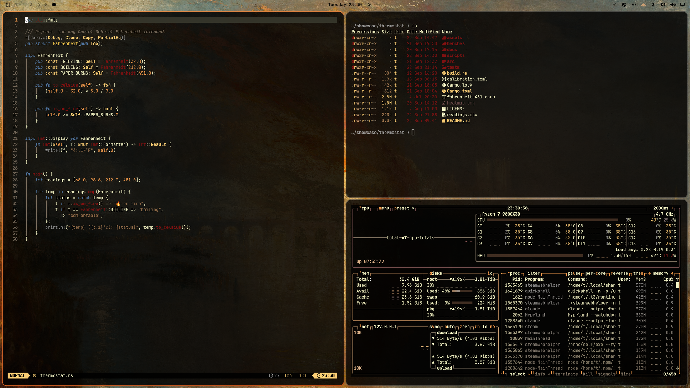
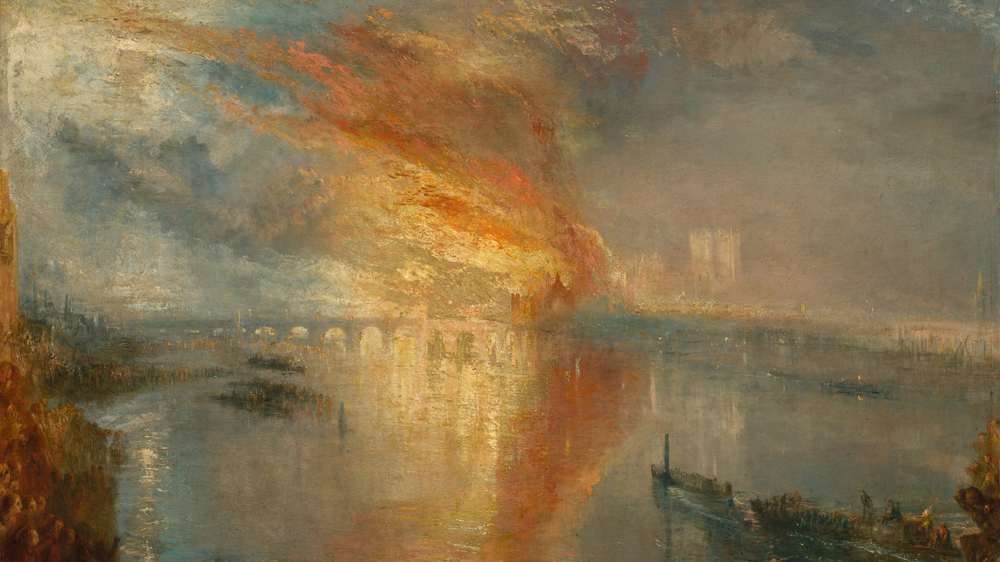

# Fahrenheit for Omarchy

A warm, dark [Omarchy](https://omarchy.org) theme ported from the iTerm2
"Fahrenheit" color scheme: pure black background, cream text, and orange accents.





## Install

```bash
omarchy theme install https://github.com/tracer123/omarchy-fahrenheit-theme.git
```

This clones the theme into `~/.config/omarchy/themes/fahrenheit` and applies
it. Switch back to it later with `omarchy theme set fahrenheit` or the theme
switcher.

**Heads up:** installing replaces any existing
`~/.config/omarchy/themes/fahrenheit` directory.

## Update

```bash
omarchy theme update
```

## Remove

Switch to another theme first, since removing doesn't change the active theme:

```bash
omarchy theme set gruvbox
omarchy theme remove fahrenheit
```

This deletes `~/.config/omarchy/themes/fahrenheit`.

## What's included

- `colors.toml`: the palette. Omarchy generates the terminal, Neovim, btop,
  VS Code, and other app themes from it.
- `backgrounds/`: *The Burning of the Houses of Lords and Commons, 16 October
  1834* by J. M. W. Turner, cropped to 3840×2160.
- `icons.theme`: the Yaru (orange) icon set.
- `preview.png`: the image shown in the theme switcher.

The terminal colors keep the original scheme's unusual mapping: "red" is tan,
"blue" is oxblood, and bright magenta is blue.

## Credits

- Color scheme: "Fahrenheit" from
  [iTerm2-Color-Schemes](https://github.com/mbadolato/iTerm2-Color-Schemes).
- Wallpaper: J. M. W. Turner, 1834–35, Cleveland Museum of Art. Public domain,
  via [Wikimedia Commons](https://commons.wikimedia.org/wiki/File:Joseph_Mallord_William_Turner_-_The_Burning_of_the_Houses_of_Lords_and_Commons,_16_October_1834_-_1942.647_-_Cleveland_Museum_of_Art.jpg).
